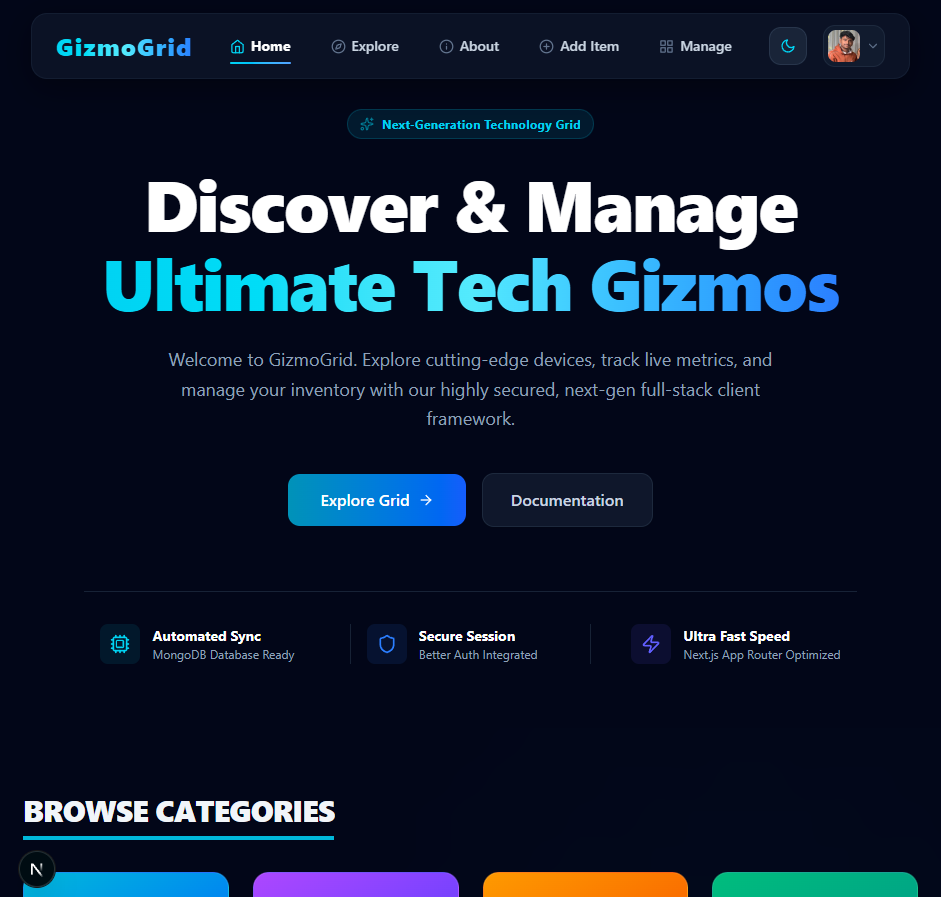

<div align="center">

# 🛒 GizmoGrid | Next-Gen Tech Gadgets Marketplace



A secure, feature-rich full-stack marketplace for smart devices and tech gadgets, with an immersive dark-themed UI and multi-role authentication.


[🌐 Live Demo](https://gizmogrid-kohl.vercel.app/) · [🖥️ Server Repo](https://github.com/SBHimel/GizmoGrid-Server-SCIC)

</div>

---

## ✨ Overview

**GizmoGrid** connects tech enthusiasts, buyers and sellers through a fast, dark-themed interface built on the **Next.js 16 App Router**. It supports four user roles, each with its own protected dashboard.

---

## 🌟 Key Features

- **🎨 Premium Tech UI:** HeroUI v3 + Tailwind CSS v4 with a responsive dark/light theme.
- **⚡ High Performance:** Next.js 16 and React 19 with SSR, dynamic filtering and optimized images.
- **📊 Analytics Dashboards:** Interactive charts with Recharts.
- **🎞️ Micro-interactions:** Framer Motion animations and React CountUp stat counters.
- **🔔 Notifications:** Toasts via `sonner` and `react-hot-toast`.
- **🛍️ Marketplace:** Category browsing (Electronics, Gadgets, Clothing, Shoes), search and filtering.

---

## 🔒 Security & Authentication

- **Better Auth** with `@better-auth/mongo-adapter` for session and user management.
- **Social login:** Google OAuth and Facebook Login.
- **JWT handling** with `jose`.
- **MongoDB** for users, products and orders.
- **Role-Based Access Control (RBAC):** route middleware and authorization gates.

---

## 👥 Roles & Portals

| Role        | Responsibilities                                                                          | Protected Routes        |
| ----------- | ----------------------------------------------------------------------------------------- | ----------------------- |
| **Admin**   | Manage users, monitor analytics, supervise seller listings                                | `/dashboard/admin/*`    |
| **Manager** | Moderate activity, approve/reject listings, handle reports                                | `/dashboard/manager/*`  |
| **Seller**  | Add gadgets, manage inventory, track sales metrics                                        | `/dashboard/seller/*`   |
| **Buyer**   | Explore catalog, filter by category, manage cart, purchase devices                        | `/dashboard/buyer/*`    |

---

## 🛠 Tech Stack

| Category        | Technologies                                                   |
| --------------- | -------------------------------------------------------------- |
| Framework       | Next.js 16 (App Router), React 19, TypeScript                  |
| Auth & Database | Better Auth, Better Auth Mongo Adapter, MongoDB, Jose          |
| Styling         | Tailwind CSS v4, HeroUI v3, Next Themes                        |
| Icons           | Lucide React, React Icons, Gravity UI Icons                    |
| Data Viz/Motion | Recharts, Framer Motion, React CountUp                         |
| Notifications   | Sonner, React Hot Toast                                        |
| Deployment      | Vercel                                                         |

---

## 📁 Project Structure

```
GizmoGrid-Client-SCIC/
├── public/               # Favicons, logo, screenshots
├── src/
│   ├── app/              # App Router pages, layouts and API routes
│   │   ├── api/auth/     # Better Auth callbacks (Google/Facebook)
│   │   ├── dashboard/    # Role-based dashboards
│   │   ├── globals.css   # Global styles & Tailwind directives
│   │   └── layout.tsx    # Root layout (theme provider, toaster, metadata)
│   ├── components/       # Reusable UI components
│   └── lib/              # DB connection and auth config
├── next.config.ts
└── package.json
```

---

## 🚀 Getting Started

### Prerequisites
- Node.js 20+
- A MongoDB database
- The [GizmoGrid server](https://github.com/SBHimel/GizmoGrid-Server-SCIC) running

### Installation

```bash
git clone https://github.com/SBHimel/GizmoGrid-Client-SCIC.git
cd GizmoGrid-Client-SCIC
npm install
```

### Environment Variables

Create a `.env.local` file in the root:

```env
BETTER_AUTH_SECRET=your_secret
BETTER_AUTH_URL=http://localhost:3000
MONGODB_URI=your_mongodb_connection_string
NEXT_PUBLIC_API_URL=your_backend_server_url
GOOGLE_CLIENT_ID=your_google_client_id
GOOGLE_CLIENT_SECRET=your_google_client_secret
FACEBOOK_CLIENT_ID=your_facebook_app_id
FACEBOOK_CLIENT_SECRET=your_facebook_app_secret
```

### Run

```bash
npm run dev      # development
npm run build    # production build
npm run start    # run production build
```

### Deploy

```bash
vercel --prod
```

---

## 🛡 Security Checklist

- [x] Production redirect URIs locked in Google and Meta developer consoles
- [x] Environment variables stored securely in Vercel
- [x] Route segmentation per role (Admin / Manager / Seller / Buyer)

---

## 👨‍💻 Author

Created and maintained with ❤️ by [S.B. Himel](https://github.com/SBHimel)

[LinkedIn](https://www.linkedin.com/in/sbhimel/) · [Facebook](https://www.facebook.com/s.b.himel.669113)
